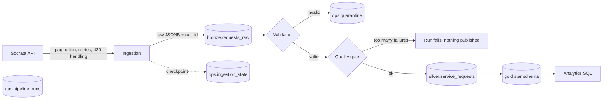
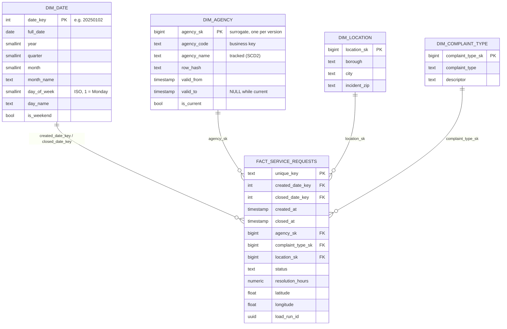

# NYC 311 Data Pipeline

A dockerized Python pipeline that ingests NYC 311 Service Requests from the NYC Open Data
(Socrata) API, validates and cleans them, and loads them into PostgreSQL using a
bronze / silver / gold (medallion) structure, with analytical SQL on top.

Team project for the Data Engineering course (Fall 2026).

## Team

| Name | Role | Owns |
|---|---|---|
| Royal Esgerov | #1 Ingestion & Silver | Socrata API client, resumable bronze ingestion, schema drift detection, validation rules, quarantine, quality gate, silver layer |
| Sahin Bedelov | #2 Database & Analytics | Schema and migrations, gold star schema (SCD2), bulk loading, performance tuning, analytics SQL |
| Murad Huseynov | #3 Platform & Operations | Docker, CI/CD, pre-commit, orchestrator and CLI, scheduler, run tracking, backfill, failure and recovery testing |

Everyone reviews each other's PRs and must be able to explain the whole system.

## Quick start

```bash
cp .env.example .env          # edit .env and set your own POSTGRES_PASSWORD and SOCRATA_APP_TOKEN
docker compose up -d postgres
docker compose run --rm pipeline python -m pipeline.cli --mode incremental
```

Backfill a historical window (the end date is **exclusive**):

```bash
docker compose run --rm pipeline python -m pipeline.cli --mode backfill --from 2025-01-01 --to 2025-02-01
```

Or load the whole 5-month dataset month by month (each month is its own tracked, resumable run):

```bash
bash scripts/backfill.sh
```

Start the long-running cron scheduler (`SCHEDULE_CRON`, default daily at `03:00` UTC):

```bash
docker compose --profile scheduler up -d scheduler
```

Inspect run history:

```sql
SELECT run_id, mode, status, rows_ingested, rows_quarantined, rows_silver, rows_gold, error
FROM ops.pipeline_runs ORDER BY started_at DESC;
```

Open a `psql` session:

```bash
docker compose exec postgres psql -U pipeline -d nyc311
```

### Three operational rules that protect your data

1. **The scheduler is profile-gated (`profiles: ["scheduler"]`).** Its first run loads everything since the newest ingested row (`max(source_created_at)`). Start it only when you intend to ingest up to today, or pass `-e POSTGRES_DB=nyc311_demo` for isolated testing.
2. **Integration tests truncate all tables.** The `db_conn` fixture in `tests/conftest.py` runs `TRUNCATE ... RESTART IDENTITY CASCADE` before every test. Always point `pytest` at a dedicated test database (`nyc311_test`), never your backfilled `nyc311` database.
3. **Check the first log lines of any run.** `run <id> started: mode=... window=...` confirms which window and database the process is targeting.

## Local development setup

Requirements: Python 3.11+, Docker Desktop, Git.

```powershell
# Windows PowerShell
python -m venv .venv
.venv\Scripts\Activate.ps1
pip install -r requirements-dev.txt
pre-commit install
```

```bash
# macOS / Linux
python -m venv .venv
source .venv/bin/activate
pip install -r requirements-dev.txt
pre-commit install
```

### Environment variables

Copy `.env.example` to `.env`. **Never commit `.env`.**

| Variable | Purpose |
|---|---|
| `POSTGRES_USER`, `POSTGRES_PASSWORD`, `POSTGRES_DB`, `POSTGRES_PORT` | Database credentials. Choose your own password. |
| `POSTGRES_HOST` | `postgres` inside Docker, `localhost` when running tests or scripts on your machine |
| `SOCRATA_APP_TOKEN` | Free token from data.cityofnewyork.us, avoids hard rate limits |
| `SOCRATA_DATASET_ID` | `erm2-nwe9` (311 Service Requests from 2010 to present) |
| `SOCRATA_PAGE_SIZE` | Rows per API page (default `5000`) |
| `QUALITY_FAIL_THRESHOLD` | Fail the run if more than this share of records is invalid (default `0.05`) |
| `INITIAL_LOOKBACK_DAYS` | First incremental run on an empty database looks back this many days (default `30`) |
| `SCHEDULE_CRON` | Scheduler cron expression (default `0 3 * * *`, daily at 03:00) |
| `LOG_LEVEL` | `INFO` by default |

### Running the tests

Unit tests run without external dependencies. Integration tests require PostgreSQL and a **separate test database** because `db_conn` truncates all tables:

```powershell
docker compose up -d postgres
docker compose exec postgres psql -U pipeline -d postgres -c "CREATE DATABASE nyc311_test;"

$env:POSTGRES_HOST = "localhost"
$env:POSTGRES_PORT = "5432"
$env:POSTGRES_USER = "pipeline"
$env:POSTGRES_PASSWORD = "<the value from your .env>"
$env:POSTGRES_DB = "nyc311_test"
pytest -q
```

```bash
export POSTGRES_HOST=localhost POSTGRES_PORT=5432 POSTGRES_USER=pipeline POSTGRES_DB=nyc311_test
export POSTGRES_PASSWORD='<the value from your .env>'
pytest -q
```

Before every push, run the same checks CI runs:

```bash
ruff check .
ruff format --check .
pytest -q
```

## Architecture



### Run lifecycle (`pipeline.run_pipeline`)

1. **Connect with retry (`db.get_connection`):** retries `psycopg2.OperationalError` with exponential backoff (`2s`, `4s`, `8s`, capped at `10s`, up to `max_wait_s=60`) until PostgreSQL accepts connections.
2. **Prevent overlapping runs:** acquires session-level PostgreSQL advisory lock `727312` (`pg_try_advisory_lock`). If another container or process holds the lock, the run logs a warning and exits cleanly.
3. **Migrate & recover stale state:** applies pending numbered SQL files via `migrate.apply_migrations` and runs `runs.mark_stale_runs` to mark any leftover `running` rows from a crashed container as `failed`.
4. **Resolve window & track run:** determines `[date_from, date_to)` via `ingest.resolve_window` and inserts a `running` row into `ops.pipeline_runs`.
5. **Resumable bronze ingestion:** fetches pages from Socrata and upserts each page into `bronze.requests_raw` in the same transaction that advances `ops.ingestion_state.next_offset`.
6. **Validation, quarantine & quality gate:** validates bronze rows for the current `run_id` using two separate database connections (`silver_conn` and `quarantine_conn`) so quarantine rows commit immediately while silver remains uncommitted until the failure ratio passes `QUALITY_FAIL_THRESHOLD`.
7. **Gold load:** executes set-based SQL in `gold.load_gold` inside a single transaction to update dimensions, apply SCD Type 2 versioning on `gold.dim_agency`, and upsert `gold.fact_service_requests`.
8. **Finalize tracking:** updates `ops.pipeline_runs` to `success` with layer row counts, or `failed` with the exception class and message on error, releasing the advisory lock on connection close.

### Infrastructure, CI/CD & Orchestration

| Component | Design & Responsibility |
|---|---|
| **CLI (`pipeline.cli`)** | Supports `--mode incremental` and `--mode backfill --from YYYY-MM-DD --to YYYY-MM-DD` (validating date format and `--from < --to`). Exits `0` on success and `1` on failure so Docker and CI detect failures immediately. |
| **Scheduler (`pipeline.scheduler`)** | Uses APScheduler `BlockingScheduler` with `CronTrigger.from_crontab(SCHEDULE_CRON)`, `max_instances=1`, `coalesce=True`, and an immediate startup execution. Exceptions are caught and logged inside `job()` so transient API/DB errors never crash the container. Chosen over Airflow to avoid multi-container scheduler/worker/metadata overhead for a single-DAG cron workload. |
| **Docker image (`Dockerfile`)** | Two-stage build on `python:3.11-slim`: Stage 1 installs runtime dependencies (`requirements.txt`) into `/install`; Stage 2 copies `/install`, `src/`, `migrations/`, and `queries/` into a clean runtime image running as non-root user `app` (`uid` system user), with `.env` excluded via `.dockerignore` and a Python `HEALTHCHECK` verifying module imports and DB connectivity. |
| **Docker Compose (`docker-compose.yml`)** | Runs `postgres:16` with named volume `pgdata` and a `pg_isready` healthcheck (`5s` interval, `10` retries). `pipeline` (`profiles: ["manual"]`) and `scheduler` (`profiles: ["scheduler"]`) both declare `depends_on: postgres: condition: service_healthy`. |
| **CI/CD (`.github/workflows/ci.yml`)** | Runs on every pull request and push to `main`: `lint-test` (required status check on `main` running `ruff check`, `ruff format --check`, and `pytest -q` against a `postgres:16` service container) and `docker-build` (verifying the multi-stage image builds cleanly). |
| **Pre-commit (`.pre-commit-config.yaml`)** | Enforces trailing-whitespace removal, EOF newlines, YAML syntax checks, large-file blocking, private-key detection, `ruff --fix`, `ruff-format`, and `detect-secrets`. |

## Data model

All tables are created by numbered SQL migrations in `migrations/`, applied once each, in
filename order, by `src/pipeline/migrate.py` (applied files are recorded in
`ops.schema_migrations`). An empty database gets the full schema on first start.

### Layers

| Layer | Table | Grain (one row per...) | Key | Purpose |
|---|---|---|---|---|
| bronze | `bronze.requests_raw` | API record | `source_id` (the API `unique_key`) | Raw JSON payload exactly as received, so silver can be rebuilt without calling the API again |
| silver | `silver.service_requests` | service request | `unique_key` | Typed, validated, cleaned columns. Only records that passed the quality rules |
| gold | `gold.fact_service_requests` + 4 dimensions | service request | `unique_key` | Star schema for analytics (see below) |
| ops | `ops.pipeline_runs` | pipeline run | `run_id` | Run tracking: mode, window, status, row counts per layer, error |
| ops | `ops.ingestion_state` | source + date window | `(source, window_key)` | Checkpoints (next offset) that make ingestion resumable |
| ops | `ops.quarantine` | rejected record + rule | `(source_id, rule_name)` | Bad records with the rule they broke and why; never dropped silently |

Every silver row keeps `bronze_run_id` and every fact row keeps `load_run_id`, so each row
can be traced back to the run that produced it.

### Gold star schema

The fact table has one row per 311 request. It holds the measures (`resolution_hours`,
coordinates), the timestamps and `status` (a degenerate dimension), and points to four
dimensions:



- **`dim_date`** has one row per calendar day. The key is the date as an integer
  (`20250102`), so the fact table can be joined or filtered by date without functions.
  Each load adds the days it needs.
- **`dim_location`** and **`dim_complaint_type`** are Type 1 dimensions. Their natural
  attributes are unique, and missing values become `'UNKNOWN'` so every fact row finds a
  match.
- **`dim_agency`** keeps history (SCD Type 2, next section).

`gold.py` loads everything in one transaction with set-based SQL. Gold is either fully
updated for a run or left untouched.

### SCD Type 2: `gold.dim_agency`

Agencies get renamed over time. If we overwrote the name, old requests would show the new
name and history would be lost. With SCD2, each change adds a **new version row** instead.

| agency_sk | agency_code | agency_name | valid_from | valid_to | is_current |
|---|---|---|---|---|---|
| 1 | NYPD | Police Department | 1970-01-01 | 2025-03-01 09:00 | false |
| 2 | NYPD | NYC Police Department | 2025-03-01 09:00 | NULL | true |

- **Tracked attribute:** `agency_name`. **Business key:** `agency_code`.
- **Surrogate key:** `agency_sk` identifies one *version*. `agency_code` alone cannot be
  the primary key, because the same agency has several rows. The fact table stores
  `agency_sk`, so each request points at one exact version.
- **Change detection:** each load stages one row per agency with
  `row_hash = md5(agency_code | agency_name)`. Comparing one hash is cheaper and simpler
  than comparing every column.
- **Closing and opening a version:** when the hash differs from the current version, the
  current row gets `valid_to = now, is_current = false`, and a new row is inserted with
  `valid_from = now, valid_to = NULL, is_current = true`. Both use `LOCALTIMESTAMP` (the
  transaction start time), so the old version ends exactly when the new one starts: no
  gaps, no overlaps. The very first version of an agency starts at `1970-01-01`, so
  requests older than the first load still find it.
- **One current version per agency** is enforced by the database with a partial unique
  index: `UNIQUE (agency_code) WHERE is_current`.
- **As-of join in the fact load:** a request is linked to the version that was valid when
  the request was *created*, not simply to the current one:

  ```sql
  JOIN gold.dim_agency a
    ON a.agency_code = s.agency
   AND s.created_date >= a.valid_from
   AND (a.valid_to IS NULL OR s.created_date < a.valid_to)
  ```

  In the example above, a request from February keeps `"Police Department"` and a request
  from April gets `"NYC Police Department"`. Agency reports that should ignore renames
  group by `agency_code`.

## Data quality rules

Every bronze record for a run is validated in `src/pipeline/validate.py` before anything is
written to silver. Invalid records are never dropped silently—they are written to
`ops.quarantine` with the `rule_name`, human-readable `reason`, and raw JSON payload.

| Rule name | What it checks | Action |
|---|---|---|
| `required_field_missing` | `unique_key`, `created_date`, `agency`, `complaint_type`, and `status` are present and non-empty | Quarantine |
| `invalid_created_date` | `created_date` parses as a valid ISO timestamp | Quarantine |
| `created_in_future` | `created_date` is not later than the current time | Quarantine |
| `invalid_closed_date` | `closed_date`, when present, parses as a valid ISO timestamp | Quarantine |
| `closed_before_created` | `closed_date` is not earlier than `created_date` | Quarantine |
| `invalid_status` | `status` is in the verified `ALLOWED_STATUS` set | Quarantine |
| `coordinates_out_of_range` | `latitude` and `longitude`, when present, are numeric and inside the NYC bounding box (`40.3..41.1`, `-74.5..-73.5`) | Quarantine |

### Quality gate

`src/pipeline/silver.py` tracks the invalid ratio (`invalid / total`) across the run and
compares it against `QUALITY_FAIL_THRESHOLD` (default `0.05`, or 5%).

- **Two separate DB connections (`silver_conn` and `quarantine_conn`):** silver upserts
  stay inside one open transaction on `silver_conn`, while quarantined rows are committed
  immediately on `quarantine_conn`.
- **When the gate trips (`ratio > threshold`):** `silver_conn` is rolled back so nothing
  is published to silver or gold, `QualityGateError` is raised, the run is marked `failed`
  in `ops.pipeline_runs`, and all quarantined rows remain in `ops.quarantine` for
  investigation.

## Idempotency and resumability

### Idempotent loads

Running the pipeline again for the same window gives exactly the same tables: no
duplicates, no extra versions. Every write is keyed and uses an upsert instead of a plain
insert.

| Step | Unique key | On rerun |
|---|---|---|
| Migrations | `ops.schema_migrations.filename` | Already applied files are skipped |
| Bronze | `source_id` | `ON CONFLICT DO UPDATE`: the record is replaced, not duplicated |
| Silver | `unique_key` | `ON CONFLICT DO UPDATE`: the latest valid version of the request wins |
| Quarantine | `(source_id, rule_name)` | The same bad record is stored once per rule |
| `dim_date`, `dim_location`, `dim_complaint_type` | natural attributes | `ON CONFLICT DO NOTHING` |
| `dim_agency` (SCD2) | `row_hash` of the current version | Same hash, so nothing is closed or added |
| `fact_service_requests` | `unique_key` | `ON CONFLICT DO UPDATE` |

Large batches are written with `COPY` into a temporary staging table followed by a single
`INSERT ... ON CONFLICT` (`src/pipeline/bulk.py`). This is much faster than one `INSERT`
per row and keeps the same upsert behaviour.

The gold load runs in a single transaction. If it fails halfway, nothing is committed and
the rerun starts from a clean state.

This is proven by integration tests in `tests/integration/test_gold.py` and
`tests/integration/test_pipeline_e2e.py`: loading the same run twice leaves every table
with identical row counts, and repeating a load after an agency rename does not create a
third version.

### Resumability

Ingestion checkpoints are stored in `ops.ingestion_state` keyed by `(source, window_key)`
(for example `('nyc311', '2025-01-01|2025-02-01')`), tracking `next_offset` and `status`
(`in_progress` or `complete`).

- **Single-transaction batch + checkpoint:** in `src/pipeline/ingest.py`, upserting a page
  into `bronze.requests_raw` and advancing `next_offset` in `ops.ingestion_state` happen
  inside one PostgreSQL transaction. If the container is killed mid-run, either both
  committed or neither did.
- **`in_progress` vs `complete`:**
  - If no state exists yet, ingestion starts at offset `0`.
  - If the window is `in_progress`, a previous run died mid-window—ingestion resumes from
    the saved `next_offset`, and `_adopt_interrupted_rows` re-tags bronze rows from earlier
    failed runs of the same window with the new `run_id` so silver and gold process the
    complete window.
  - If the window is `complete`, restarting that window resets `next_offset` to `0` and
    refreshes it cleanly via idempotent upserts.

### API change detection

Because Socrata omits null fields from individual JSON records, schema drift cannot be
judged per record. `src/pipeline/schema_check.py` inspects the **union of keys across an
entire page**:

- **Breaking change (fails the run):** if any core column (`unique_key`, `created_date`,
  `agency`, `complaint_type`, `status`) is absent from the entire page, `check_schema`
  raises `SchemaDriftError` and aborts the run.
- **Non-breaking addition (warning only):** if a new column appears outside
  `KNOWN_COLUMNS`, a warning is logged and ingestion continues.

## Backfill and incremental runs

| Mode | CLI invocation | Window calculation | Purpose |
|---|---|---|---|
| **Incremental** | `python -m pipeline.cli --mode incremental` | `[max(source_created_at) - 1 day, tomorrow)` (1-day overlap safely absorbed by upserts; falls back to `INITIAL_LOOKBACK_DAYS` on an empty DB) | Daily scheduled sync via `scheduler` |
| **Backfill** | `python -m pipeline.cli --mode backfill --from YYYY-MM-DD --to YYYY-MM-DD` | Explicit `[from, to)` range (`--to` is exclusive) | Historical loads and targeted re-runs |

### Benchmark dataset (`2025-01-01` to `2025-06-01`)

Executed month by month via `scripts/backfill.sh` (each month recorded as an individual tracked run in `ops.pipeline_runs`):

| Month | Window | Ingested | Quarantined | Gold rows | Failure ratio |
|---|---|---|---|---|---|
| 2025-01 | `2025-01-01..2025-02-01` | 348,241 | 99 | 348,142 | 0.0003 |
| 2025-02 | `2025-02-01..2025-03-01` | 255,420 | 129 | 255,291 | 0.0005 |
| 2025-03 | `2025-03-01..2025-04-01` | 281,284 | 136 | 281,148 | 0.0005 |
| 2025-04 | `2025-04-01..2025-05-01` | 272,600 *(resumed from 190k)* | 91 | 272,509 | 0.0003 |
| 2025-05 | `2025-05-01..2025-06-01` | 295,109 | 55 | 295,054 | 0.0002 |
| **Total** | | **1,452,654** | **510** | **1,452,144** | **0.0004** |

During the April 2025 backfill, an upstream `IncompleteRead` interrupted the stream at offset `190,000`. Re-running April resumed automatically from offset `190,000`, fetched the remaining `82,600` rows, adopted the `190,000` pre-crash rows (`272,600` total), and completed without duplicating any records.

## Failure and recovery demos

### Demo A: Killed container mid-ingestion (checkpoint resume & stale run cleanup)

1. Started a backfill for `2025-06-01..2025-07-01` in a named container (`pipe-demo`) and killed it mid-stream with `docker kill pipe-demo` after two batches (`10,000` rows):

```text
$ docker compose run --rm --name pipe-demo pipeline python -m pipeline.cli --mode backfill --from 2025-06-01 --to 2025-07-01
2026-11-25 14:37:07,278 INFO pipeline.pipeline run d7db5d86-ddb4-4d76-ab11-6d9369c163f0 started: mode=backfill window=2025-06-01..2025-07-01
2026-11-25 14:37:07,282 INFO pipeline.ingest ingesting 2025-06-01|2025-07-01 starting at offset 0
2026-11-25 14:37:15,409 INFO pipeline.ingest loaded 5000 rows (offset now 5000)
2026-11-25 14:37:19,838 INFO pipeline.ingest loaded 10000 rows (offset now 10000)

$ docker kill pipe-demo
```

2. Verified `ops.ingestion_state` saved `next_offset = 10000` (`status = in_progress`) and `ops.pipeline_runs` still showed `d7db5d86-ddb4-4d76-ab11-6d9369c163f0` as `running`:

```text
 source |      window_key       | next_offset |   status    |          updated_at
--------+-----------------------+-------------+-------------+------------------------------
 nyc311 | 2025-06-01|2025-07-01 |       10000 | in_progress | 2026-11-25 14:37:19.55453+00

                run_id                |    mode     | date_from  |  date_to   | status  |          started_at           | finished_at
--------------------------------------+-------------+------------+------------+---------+-------------------------------+-------------
 d7db5d86-ddb4-4d76-ab11-6d9369c163f0 | backfill    | 2025-06-01 | 2025-07-01 | running | 2026-11-25 14:37:07.275164+00 |
```

3. Re-ran the identical backfill command. `mark_stale_runs` marked the killed run `failed` (`process died before the run finished`), ingestion resumed from offset `10000`, `_adopt_interrupted_rows` adopted the `10,000` pre-crash rows (`306,489` total validated, `306,432` loaded to silver/gold), and Bronze confirmed zero duplicate `source_id`s:

```text
2026-11-25 14:52:52,435 INFO pipeline.ingest loaded 296489 rows (offset now 306489)
2026-11-25 14:53:11,445 INFO pipeline.silver validation done: total=306489 valid=306432 invalid=57 ratio=0.0002
2026-11-25 14:53:29,024 INFO pipeline.gold gold load done for run 6d6e05cf-2ef9-4f9b-8e3d-167ea87ebb87: 306432 fact rows
2026-11-25 14:53:29,027 INFO pipeline.pipeline run 6d6e05cf-2ef9-4f9b-8e3d-167ea87ebb87 succeeded: {'rows_ingested': 296489, 'rows_silver': 306432, 'rows_quarantined': 57, 'rows_gold': 306432}

                run_id                |   mode   | status  | rows_ingested | rows_silver | rows_gold |                error
--------------------------------------+----------+---------+---------------+-------------+-----------+--------------------------------------
 6d6e05cf-2ef9-4f9b-8e3d-167ea87ebb87 | backfill | success |        296489 |      306432 |    306432 |
 d7db5d86-ddb4-4d76-ab11-6d9369c163f0 | backfill | failed  |             0 |           0 |         0 | process died before the run finished

 source |      window_key       | next_offset |  status
--------+-----------------------+-------------+----------
 nyc311 | 2025-06-01|2025-07-01 |      306489 | complete

 total_bronze | distinct_source_ids
--------------+---------------------
      1759143 |             1759143
```

### Demo B: Database not ready at startup (two layers of protection)

1. **Layer 1 — Docker Compose `service_healthy` gate:** Starting `scheduler` from a cold stack holds container startup for `5.9s` until `postgres` passes `pg_isready`:

```text
$ docker compose --profile scheduler up -d scheduler
[+] Running 3/3
 ✔ Network nyc311-data-pipeline_default        Created                             0.0s
 ✔ Container nyc311-data-pipeline-postgres-1   Healthy                             5.9s
 ✔ Container nyc311-data-pipeline-scheduler-1  Started                             6.1s
```

2. **Layer 2 — Python retry loop (`src/pipeline/db.py`):** Stopping `postgres` and launching `pipeline` with `--no-deps` triggers exponential backoff (`2s`, `4s`, `8s`) until `docker compose start postgres` brings the database up, after which the run connects and begins ingesting automatically:

```text
$ docker compose run --rm --no-deps pipeline python -m pipeline.cli --mode incremental
2026-11-25 14:56:32,621 WARNING pipeline.db database not ready (attempt 1): could not translate host name "postgres" to address: Name or service not known; retrying in 2s
2026-11-25 14:56:37,366 WARNING pipeline.db database not ready (attempt 2): could not translate host name "postgres" to address: Name or service not known; retrying in 4s
2026-11-25 14:56:44,097 WARNING pipeline.db database not ready (attempt 3): could not translate host name "postgres" to address: Name or service not known; retrying in 8s
2026-11-25 14:56:52,129 INFO pipeline.pipeline run b299b8cb-8afd-410b-b595-780481474b8a started: mode=incremental window=2025-07-02..2026-11-26
2026-11-25 14:56:52,131 INFO pipeline.ingest ingesting 2025-07-02|2026-11-26 starting at offset 0
2026-11-25 14:56:56,229 INFO pipeline.ingest loaded 5000 rows (offset now 5000)
```

### Demo C: Malformed batch & quality gate rollback

Running the integration test `test_malformed_batch_trips_quality_gate` feeds 100 synthetic records with 10 invalid `closed_date < created_date` rows (`10%` failure rate against the `5%` threshold):

```text
$ pytest -s tests/integration/test_pipeline_e2e.py -k malformed
tests/integration/test_pipeline_e2e.py .
======================= 1 passed, 2 deselected in 4.75s ========================
```

Inspecting PostgreSQL confirms the run is recorded as `failed`, all 10 invalid rows are preserved in `ops.quarantine`, and `silver.service_requests` and `gold.fact_service_requests` remain completely untouched (`0` rows):

```text
                run_id                |   mode   | status | rows_ingested | rows_quarantined | rows_silver | rows_gold |                             error
--------------------------------------+----------+--------+---------------+------------------+-------------+-----------+----------------------------------------------------------------
 38402772-dd52-4909-a998-294420289b0e | backfill | failed |           100 |               10 |           0 |         0 | QualityGateError: failure ratio 10.00% exceeds threshold 5.00%

       rule_name       |                  reason                  | count
-----------------------+------------------------------------------+-------
 closed_before_created | closed_date is earlier than created_date |    10

 silver_rows | gold_rows
-------------+-----------
           0 |         0
```

## Performance report

Full report with BEFORE and AFTER `EXPLAIN (ANALYZE, BUFFERS)` plans: [docs/performance_report.md](docs/performance_report.md).
Measured on 1,452,144 fact rows (January to May 2025), warm runs:

| Query | Fix | Before | After | Speedup |
|---|---|---|---|---|
| Q1 requests in one month | index `(created_date_key)` | 36.6 ms | 9.5 ms | 3.8x |
| Q2 recent open requests | index `(status, created_at)` | 41.2 ms | 0.106 ms | 388x |
| Q3 top complaint types for one agency | index `(agency_sk, complaint_type_sk)` | 30.9 ms | 1.86 ms | 16.6x |
| Q4 latest request per agency | `LATERAL` rewrite + index `(agency_sk, created_at DESC)` | > 10 min (cancelled) | 0.108 ms | > 5,000,000x |

A partitioning experiment (monthly range partitions on a copy) is also documented in the report, along with why the main fact table stays unpartitioned (preserving `ON CONFLICT (unique_key)` without altering the primary key to `(unique_key, created_at)`).

## Project layout

```text
.
├── .github/
│   └── workflows/
│       └── ci.yml                CI pipeline (ruff, pytest against Postgres 16, docker build)
├── .dockerignore                 Excludes .env, .git, .venv, tests, docs, and caches from image
├── .env.example                  Template environment variables with safe placeholders
├── .gitattributes                Enforces LF line endings on shell scripts (*.sh)
├── .gitignore                    Ignores .env, .venv, caches, and local database dumps
├── .pre-commit-config.yaml       Pre-commit hooks (ruff, detect-secrets, YAML/EOF/key checks)
├── Dockerfile                    Multi-stage non-root runtime image with healthcheck
├── docker-compose.yml            Postgres 16 + profile-gated pipeline and scheduler services
├── pyproject.toml                Ruff linter/formatter and pytest configuration
├── requirements.txt              Runtime dependencies installed in Docker image
├── requirements-dev.txt          Development and CI tooling (pytest, ruff, pre-commit)
├── docs/
│   ├── api_samples.md            Verified Socrata API sample responses and status counts
│   ├── contracts.md              Shared environment, database, and Python module contracts
│   └── performance_report.md     EXPLAIN (ANALYZE, BUFFERS) benchmarks and index trade-offs
├── migrations/
│   ├── 001_schemas_and_ops.sql   Bronze, silver, gold, and ops schemas + tracking tables
│   ├── 002_bronze_silver.sql     Bronze raw JSONB and silver typed request tables
│   ├── 003_gold.sql              Gold star schema dimensions (SCD2 dim_agency) and fact table
│   └── 004_indexes.sql           Performance indexes for slow analytical queries
├── queries/
│   ├── analytics.sql             Analytical SQL queries using CTEs and window functions
│   └── slow_queries.sql          Benchmark queries (Q1–Q4 + LATERAL rewrite)
├── scripts/
│   └── backfill.sh               Month-by-month historical backfill runner
├── src/
│   └── pipeline/
│       ├── __init__.py
│       ├── api_client.py         Socrata HTTP client with pagination, retries, and 429 handling
│       ├── bulk.py               COPY-based temporary staging bulk upsert helper
│       ├── cli.py                Command-line entry point (--mode incremental / backfill)
│       ├── config.py             Immutable Settings dataclass loaded from environment
│       ├── db.py                 PostgreSQL connection helper with exponential backoff retry
│       ├── gold.py               Set-based gold loader with SCD Type 2 versioning
│       ├── ingest.py             Resumable bronze ingestion with transactional checkpoints
│       ├── migrate.py            Idempotent numbered SQL migration runner
│       ├── pipeline.py           End-to-end run orchestrator with advisory lock
│       ├── runs.py               ops.pipeline_runs lifecycle and stale-run recovery
│       ├── scheduler.py          APScheduler cron service for periodic incremental runs
│       ├── schema_check.py       Page-level union-of-keys schema drift detector
│       ├── silver.py             Validation runner, quarantine writer, and quality gate
│       └── validate.py           Row-level NYC 311 data quality rules
└── tests/
    ├── conftest.py               Shared settings and truncating db_conn fixtures
    ├── integration/
    │   ├── test_gold.py                  SCD2 agency versioning and gold idempotency tests
    │   ├── test_ingestion_and_silver.py  Quality gate rollback and checkpoint resume tests
    │   ├── test_pipeline_e2e.py          End-to-end idempotency and malformed-batch tests
    │   └── test_runs.py                  Run tracking and stale-run cleanup tests
    └── unit/
        ├── test_api_client.py            HTTP 500/429 retry and 400 fail-fast tests
        ├── test_db_retry.py              Database startup retry backoff tests
        ├── test_schema_check.py          New-column warning and missing-core-column tests
        ├── test_smoke.py                 Package import and configuration smoke tests
        └── test_validate.py              Unit tests for all validation rules
```
