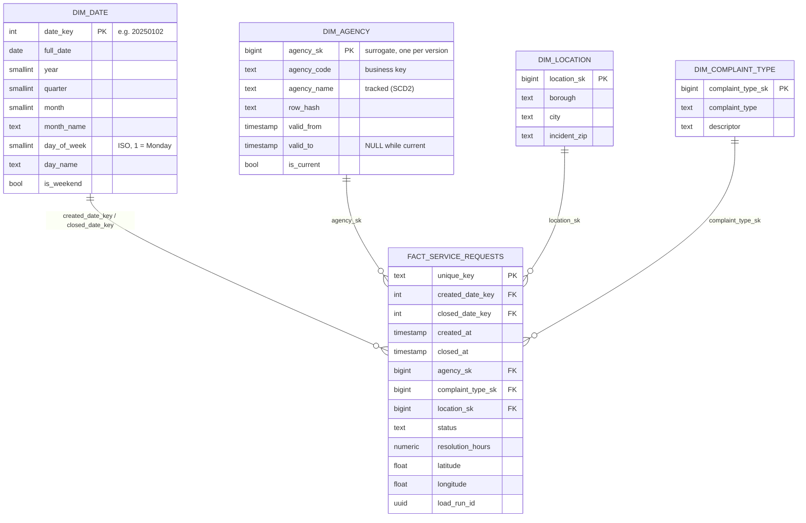

# NYC 311 Data Pipeline

A dockerized Python pipeline that ingests NYC 311 Service Requests from the
NYC Open Data (Socrata) API, validates and cleans them, and loads them into
PostgreSQL using a bronze / silver / gold (medallion) structure, with
analytical SQL on top.

## Team

| Name | Role |
|---|---|
| Murad Huseynov | _TBD_ |
| Royal Esgerov | _TBD_ |
| Sahin Bedelov | #2 Database: migrations, gold star schema, SCD2, idempotent loads, analytics, performance |

## Quick start

> TODO: fill in once docker-compose works

    cp .env.example .env
    docker compose up --build

## Architecture

> TODO: diagram (Mermaid works natively on GitHub)

## Data model

All tables are created by numbered SQL migrations in `migrations/`, applied once each, in
filename order, by `src/pipeline/migrate.py` (applied files are recorded in
`ops.schema_migrations`). An empty database gets the full schema on first start.

### Layers

| Layer | Table | Grain (one row per...) | Key | Purpose |
|---|---|---|---|---|
| bronze | `bronze.requests_raw` | API record | `source_id` (the API `unique_key`) | Raw JSON payload exactly as received, so silver can be rebuilt without calling the API again |
| silver | `silver.service_requests` | service request | `unique_key` | Typed, validated, cleaned columns. Only records that passed the quality rules |
| gold | `gold.fact_service_requests` + 4 dimensions | service request | `unique_key` | Star schema for analytics (see below) |
| ops | `ops.pipeline_runs` | pipeline run | `run_id` | Run tracking: mode, window, status, row counts per layer, error |
| ops | `ops.ingestion_state` | source + date window | `(source, window_key)` | Checkpoints (next offset) that make ingestion resumable |
| ops | `ops.quarantine` | rejected record + rule | `(source_id, rule_name)` | Bad records with the rule they broke and why; never dropped silently |

Every silver row keeps `bronze_run_id` and every fact row keeps `load_run_id`, so each row
can be traced back to the run that produced it.

### Gold star schema

The fact table has one row per 311 request. It holds the measures (`resolution_hours`,
coordinates), the timestamps and `status` (a degenerate dimension), and points to four
dimensions:



- **dim_date** has one row per calendar day. The key is the date as an integer
  (`20250102`), so the fact table can be joined or filtered by date without functions.
  Each load adds the days it needs.
- **dim_location** and **dim_complaint_type** are Type 1 dimensions. Their natural
  attributes are unique, and missing values become `'UNKNOWN'` so every fact row finds a
  match.
- **dim_agency** keeps history (SCD Type 2, next section).

`gold.py` loads everything in one transaction with set-based SQL. Gold is either fully
updated for a run or left untouched.

### SCD Type 2: `gold.dim_agency`

Agencies get renamed over time. If we overwrote the name, old requests would show the new
name and history would be lost. With SCD2, each change adds a **new version row** instead.

| agency_sk | agency_code | agency_name | valid_from | valid_to | is_current |
|---|---|---|---|---|---|
| 1 | NYPD | Police Department | 1970-01-01 | 2025-03-01 09:00 | false |
| 2 | NYPD | NYC Police Department | 2025-03-01 09:00 | NULL | true |

- **Tracked attribute:** `agency_name`. **Business key:** `agency_code`.
- **Surrogate key:** `agency_sk` identifies one *version*. `agency_code` alone cannot be
  the primary key, because the same agency has several rows. The fact table stores
  `agency_sk`, so each request points at one exact version.
- **Change detection:** each load stages one row per agency with
  `row_hash = md5(agency_code | agency_name)`. Comparing one hash is cheaper and simpler
  than comparing every column.
- **Closing and opening a version:** when the hash differs from the current version, the
  current row gets `valid_to = now, is_current = false`, and a new row is inserted with
  `valid_from = now, valid_to = NULL, is_current = true`. Both use `LOCALTIMESTAMP` (the
  transaction start time), so the old version ends exactly when the new one starts: no
  gaps, no overlaps. The very first version of an agency starts at `1970-01-01`, so
  requests older than the first load still find it.
- **One current version per agency** is enforced by the database with a partial unique
  index: `UNIQUE (agency_code) WHERE is_current`.
- **As-of join in the fact load:** a request is linked to the version that was valid when
  the request was *created*, not simply to the current one:

  ```sql
  JOIN gold.dim_agency a
    ON a.agency_code = s.agency
   AND s.created_date >= a.valid_from
   AND (a.valid_to IS NULL OR s.created_date < a.valid_to)
  ```

  In the example above, a request from February keeps "Police Department" and a request
  from April gets "NYC Police Department". Agency reports that should ignore renames
  group by `agency_code`.

## Data quality rules

> TODO: table of rule name, description, action (quarantine / fail run)

## Idempotency and resumability

### Idempotent loads

Running the pipeline again for the same window gives exactly the same tables: no
duplicates, no extra versions. Every write is keyed and uses an upsert instead of a plain
insert.

| Step | Unique key | On rerun |
|---|---|---|
| Migrations | `ops.schema_migrations.filename` | Already applied files are skipped |
| Bronze | `source_id` | `ON CONFLICT DO UPDATE`: the record is replaced, not duplicated |
| Silver | `unique_key` | `ON CONFLICT DO UPDATE`: the latest valid version of the request wins |
| Quarantine | `(source_id, rule_name)` | The same bad record is stored once per rule |
| dim_date, dim_location, dim_complaint_type | natural attributes | `ON CONFLICT DO NOTHING` |
| dim_agency (SCD2) | `row_hash` of the current version | Same hash, so nothing is closed or added |
| fact_service_requests | `unique_key` | `ON CONFLICT DO UPDATE` |

Large batches are written with `COPY` into a temporary staging table followed by a single
`INSERT ... ON CONFLICT` (`src/pipeline/bulk.py`). This is much faster than one `INSERT`
per row and keeps the same upsert behaviour.

The gold load runs in a single transaction. If it fails halfway, nothing is committed and
the rerun starts from a clean state.

This is proven by integration tests in `tests/integration/test_gold.py`: loading the same
run twice leaves every gold table with identical row counts, and repeating a load after an
agency rename does not create a third version.

### Resumability

> TODO (#1): ops.ingestion_state checkpoints, batch plus checkpoint in one transaction

## Backfill and incremental runs

> TODO: CLI examples for --mode incremental and --mode backfill

## Failure and recovery demos

> TODO: killed container, DB not ready, malformed batch (logs/screenshots)

## Git workflow and exercises

> TODO: branching model, review process, and the Git exercises we did

## Performance report

Full report with BEFORE and AFTER plans: [docs/performance_report.md](docs/performance_report.md).
Measured on 1,452,144 fact rows (January to May 2025), warm runs:

| Query | Fix | Before | After | Speedup |
|---|---|---|---|---|
| Q1 requests in one month | index `(created_date_key)` | 36.6 ms | 9.5 ms | 3.8x |
| Q2 recent open requests | index `(status, created_at)` | 41.2 ms | 0.106 ms | 388x |
| Q3 top complaint types for one agency | index `(agency_sk, complaint_type_sk)` | 30.9 ms | 1.86 ms | 16.6x |
| Q4 latest request per agency | `LATERAL` rewrite + index `(agency_sk, created_at DESC)` | > 10 min (cancelled) | 0.108 ms | > 5,000,000x |

A partitioning experiment (monthly range partitions on a copy) is also in the report, with the
reason the main table stays unpartitioned.
